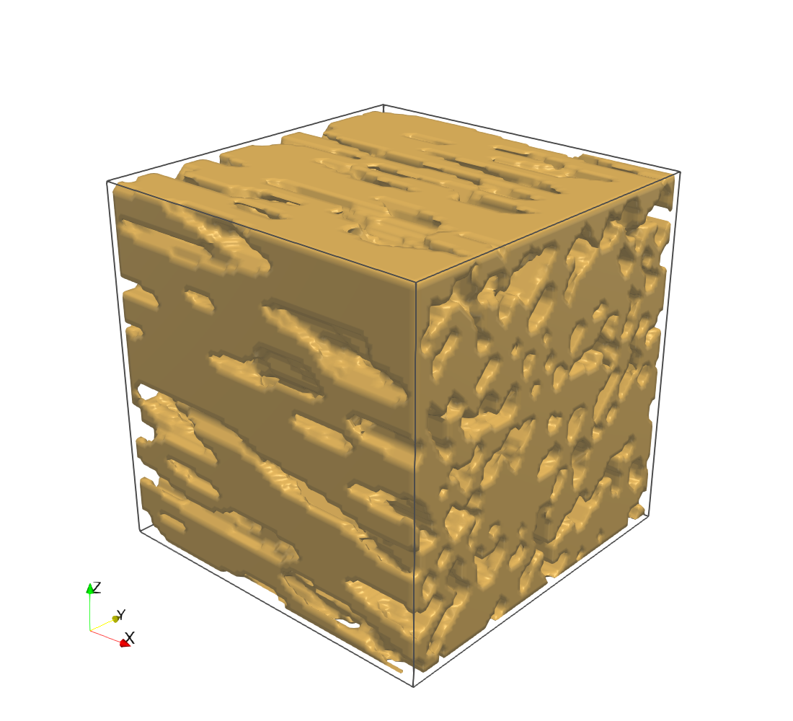
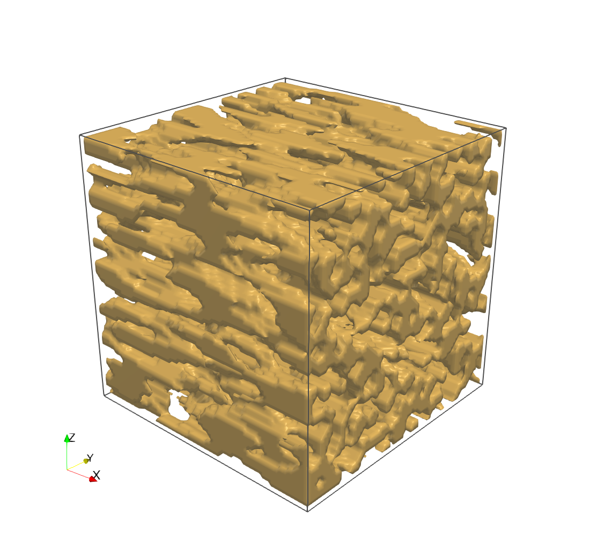
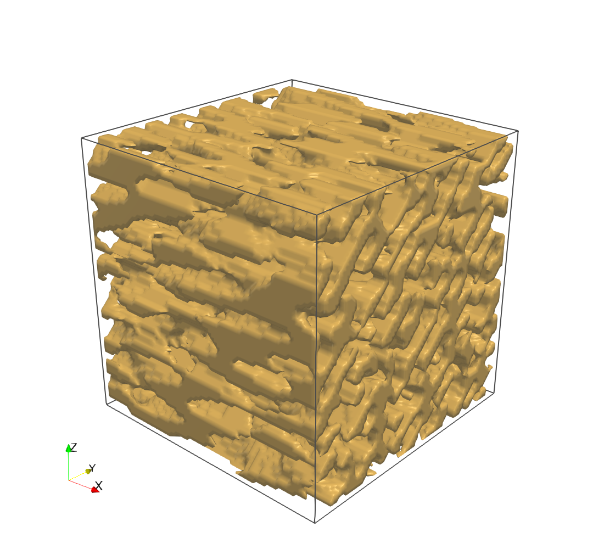
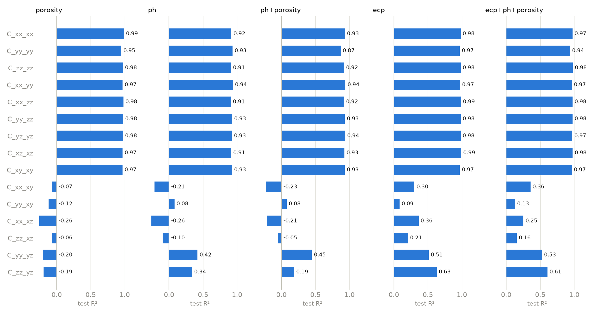
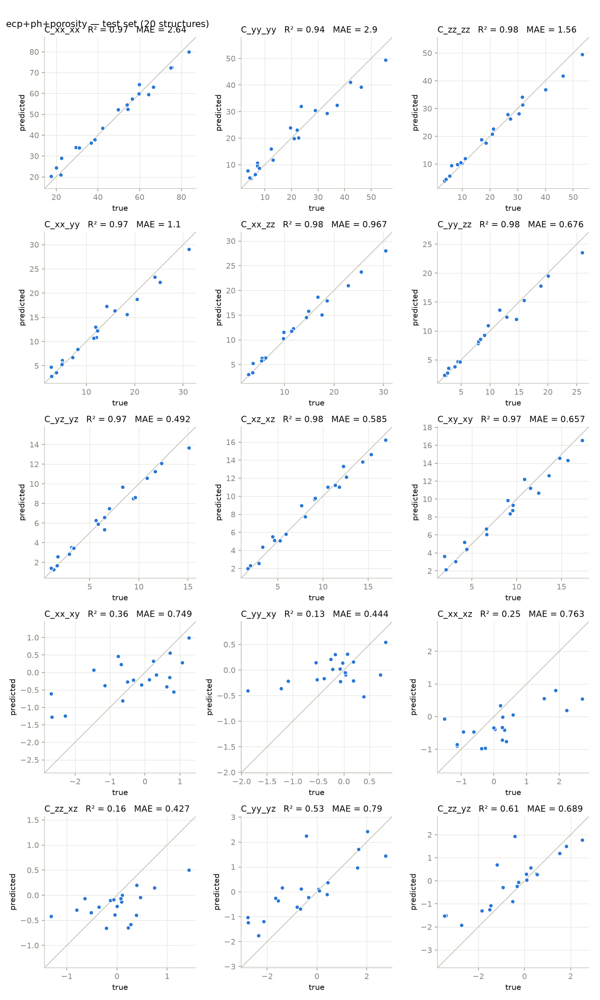

# Task A — elastic stiffness tensor from directional topology

**Goal.** Predict components of the effective elastic stiffness tensor `C_ij`
of a porous microstructure from its voxelized geometry, using direction-aware
topological descriptors and gradient-boosted trees.

Reference: R. Topolnicki *et al.*, *Direction-aware topological descriptors for
elastic stiffness tensor prediction in porous materials*,
[arXiv:2604.08105](https://arxiv.org/abs/2604.08105).

<p align="center">
  
  
  
</p>
<p align="center"><em>The first three structures, <code>rtp_000</code>–<code>rtp_002</code>
(solid phase; solid fractions 0.72, 0.44, 0.46). Rendered in ParaView.</em></p>

## Data

| file | content |
|---|---|
| `data/structures.npz` | 100 structures, bit-packed; `00_prepare_data.sh` unpacks them to `data/structures/rtp_000.npy … rtp_099.npy` |
| `data/stiffness.csv` | the labels, one row per structure |

**Structures.** Binary 80×80×80 arrays indexed `[x, y, z]`, `1` = solid,
`0` = void, periodic in all three directions. They are the first 100 structures
of the *RTP* dataset of the paper: a random field built from trigonometric
modes with random phases is thresholded to a prescribed porosity, and the
modes are stretched so that the structures are **anisotropic** — the solid is
elongated along `x` (look at the pictures above), hence stiffer along `x`
than along `y` and `z`.

**Labels.** `data/stiffness.csv` holds the full effective stiffness tensor in
Voigt notation, in GPa, for a solid phase with `E = 81.5 GPa`, `ν = 0.39`
(Au–Ag alloy). The values are copied from the dataset of the paper.

| columns | meaning |
|---|---|
| `name` | structure name, the key used everywhere |
| `solid_fraction` | solid volume fraction (= 1 − porosity) |
| `C_xx_xx, C_yy_yy, C_zz_zz` | **uniaxial** stiffnesses |
| `C_xx_yy, C_xx_zz, C_yy_zz` | **Poisson** couplings between normal strains |
| `C_yz_yz, C_xz_xz, C_xy_xy` | **shear** stiffnesses |
| `C_xx_yz, C_xx_xz, …, C_xz_xy` | 12 **off-diagonal** normal–shear and shear–shear couplings; small, of either sign, zero for an orthotropic material aligned with the axes |
| `E_x … nu_yz, A_zener, K_voigt` | engineering constants derived from the tensor |

## The descriptors

For a loading direction **d** and every solid voxel, the **cone filtration**
counts how much solid lies in a double cone with its apex on the voxel and its
axis along **d**:

```
f(voxel) = 1 − (solid voxels in the cone) / (voxels in the cone)        void voxels: 1.25
```

A voxel inside a strut that runs along **d** has `f ≈ 0`; a voxel whose
neighbourhood ends along **d** has `f` close to 1. The sublevel sets
`{f ≤ t}` therefore grow from the load-bearing material along **d** to the whole
solid, and finally to the whole box. Their topology as a function of `t` is
the descriptor:

* **PH** (`ph_<d>_<i>`): persistent homology of the cone channel in dimensions
  0, 1, 2 (components, tunnels, cavities), each diagram turned into a 12×12
  persistence image → 432 numbers per direction.
* **ECP** (`ecp_<d>_<i>`): the cone value is combined with two local
  orientation channels (from a PCA of the solid in a small sphere) into a
  3-parameter filtration; its Euler characteristic profile is sampled on a
  9×9×9 grid → 729 numbers per direction. This step runs in Julia.

Seven directions are used: the axes `[1 0 0] [0 1 0] [0 0 1]`, the face
diagonals `[1 1 0] [1 0 1] [0 1 1]` and the body diagonal `[1 1 1]`. The
direction tag in a column name is the direction with underscores, e.g.
`ph_1_1_0_17`.

## Running the task

```bash
bash 00_prepare_data.sh               # seconds
bash 01_compute_descriptors.sh        # the expensive step, see below; --no-julia skips ECP
bash 02_build_dataset.sh              # seconds
bash 03_train.sh                      # 2-3 minutes
```

or `bash run_all.sh [--no-julia] [--axes-only] [--workers=N]`.

| step | script | does | writes |
|---|---|---|---|
| 0 | `00_prepare_data.sh` | unpack the structures | `data/structures/*.npy` |
| 1 | `01_compute_descriptors.sh` | filtration → PH (GUDHI) and ECP (Julia), per direction; collect | `descriptors/ph.csv`, `descriptors/ecp.csv` |
| 2 | `02_build_dataset.sh` | join descriptors and labels on `name` | `dataset.csv` |
| 3 | `03_train.sh` | CatBoost per target and feature set; metrics on the test set; plots | `results/` |

**Cost of step 1** (100 structures, 7 directions): about 20 minutes on a
14-core workstation with ECP. The ECP is by far the most expensive part:
with `--no-julia --axes-only` the whole pipeline, training included, takes
about 3.5 minutes on the same machine. It scales
inversely with the number of cores, and `--axes-only` (3 directions instead
of 7) cuts it by more than half. Peak memory is about 0.5 GB per worker
(`--workers=N` lowers it). The step is resumable.

**No time or no Julia?** `bash 02_build_dataset.sh --reference` builds the
dataset from the shipped tables in `reference/descriptors/` (PH and ECP, all 7
directions), and `03_train.sh` then trains everything.

The parameters of every step (cone size, image resolution, targets, seed) are
plain variables at the top of the corresponding bash script — change them and
rerun.

### The model

`common/train_catboost.py` is intentionally minimal:

* one fixed split: 60 structures train, 20 validation, 20 test (`SEED=0`);
* one `CatBoostRegressor` per target (RMSE loss, 1000 iterations,
  learning rate 0.05, depth 4; for wide tables
  only a random subset of ~500 features is tried at each split);
* the validation set only selects the best iteration (early stopping);
* **R², MAE and RMSE are computed on the 20 test structures.**

Every feature set uses the same split, so the columns of the results table are
directly comparable. Per feature set, `results/<set>/` contains `metrics.csv`,
`predictions.csv`, `parity.png` (predicted vs. true on the test set) and
`importance.png` (which descriptor group and direction the model relies on).

## Reference results

Obtained with the default settings (`bash run_all.sh`); the files are in
`reference/results/`.

Test R² (20 test structures, single split, `SEED=0`); MAE values are in
`reference/results/summary.md`.

| target | porosity | ph | ph+porosity | ecp | ecp+ph+porosity |
|---|---:|---:|---:|---:|---:|
| C_xx_xx | 0.990 | 0.917 | 0.934 | 0.982 | 0.974 |
| C_yy_yy | 0.952 | 0.935 | 0.871 | 0.970 | 0.939 |
| C_zz_zz | 0.976 | 0.911 | 0.921 | 0.983 | 0.980 |
| C_xx_yy | 0.971 | 0.941 | 0.942 | 0.975 | 0.967 |
| C_xx_zz | 0.981 | 0.909 | 0.922 | 0.987 | 0.975 |
| C_yy_zz | 0.978 | 0.928 | 0.932 | 0.983 | 0.976 |
| C_yz_yz | 0.977 | 0.926 | 0.938 | 0.982 | 0.972 |
| C_xz_xz | 0.970 | 0.915 | 0.927 | 0.992 | 0.978 |
| C_xy_xy | 0.969 | 0.928 | 0.932 | 0.972 | 0.966 |
| C_xx_xy | -0.067 | -0.211 | -0.232 | 0.303 | 0.356 |
| C_yy_xy | -0.118 | 0.080 | 0.078 | 0.085 | 0.132 |
| C_xx_xz | -0.258 | -0.258 | -0.212 | 0.364 | 0.254 |
| C_zz_xz | -0.065 | -0.096 | -0.052 | 0.210 | 0.156 |
| C_yy_yz | -0.202 | 0.419 | 0.449 | 0.514 | 0.527 |
| C_zz_yz | -0.194 | 0.341 | 0.189 | 0.632 | 0.607 |
| **mean** | 0.524 | 0.572 | 0.569 | 0.729 | 0.717 |

<p align="center"></p>

How to read this:

* **Uniaxial, Poisson and shear components** (first nine rows) are dominated by
  how much material there is: the solid fraction alone gives R² ≈ 0.95–0.99,
  and no descriptor can add much on top of that with 60 training structures.
  The ECP matches it; the persistence images alone are slightly worse (thousands of
  correlated features, 60 samples).
* **Off-diagonal couplings** (last six rows) are a different story. They are
  small, change sign, and do not depend on the amount of material at all —
  porosity gives R² ≤ 0, i.e. no better than predicting the mean. The
  direction-aware descriptors are the only ones that recover part of the
  signal (R² up to ≈ 0.6). This is the main message of the paper, which
  reports on the full 500-structure dataset with 5-fold cross-validation
  R² ≈ 0.98 on the uniaxial group for all competitive methods, and on the
  off-diagonal group 0.47 for directional TDA against ≈ 0 for porosity, a
  two-point correlation function and a 3D CNN.
* The numbers are **noisy**: with `SEED=1` or `SEED=2` individual
  off-diagonal R² values of the ECP model range from −0.8 to +0.8, while
  porosity stays at or below zero on average. Compare the pattern, not the
  second decimal.

Example of the per-model output, `reference/results/ecp+ph+porosity/parity.png`:

<p align="center"></p>

## Things to try

1. **Direction matters.** Train on the descriptors of a single direction and
   predict all three uniaxial components:
   ```bash
   python ../common/train_catboost.py --dataset dataset.csv \
       --targets C_xx_xx C_yy_yy C_zz_zz --features ph --directions 1_0_0 --label ph_x_only
   ```
   Which component is predicted best? Repeat with `0_1_0` and `0_0_1`.
2. **Read `importance.png`.** For `C_xx_xx`, which direction carries the
   importance? And for `C_xy_xy`?
3. **Change the filtration.** Edit `CONE_RADIUS` / `CONE_HEIGHT` in
   `01_compute_descriptors.sh` (delete `work/` first) — a narrow, long cone is
   more selective in direction, a wide one averages more.
4. **Another seed.** `SEED=1` in `03_train.sh`: how much do the test metrics
   move? What does that say about conclusions drawn from 20 test structures?
5. **Other targets.** Any column of `data/stiffness.csv` can be a target, e.g.
   the Young moduli `E_x E_y E_z` or the anisotropy ratio you compute yourself.
6. **Look at a filtration.** In Python:
   ```python
   import sys, numpy as np; sys.path.insert(0, "scripts")
   from cone_filtration import compute
   f = compute(np.load("data/structures/rtp_000.npy"), direction=(1, 0, 0))
   print(f.shape)        # (80, 80, 80, 3): cone, dir_y, dir_z
   ```
   Plot a slice of `f[..., 0]` for `(1, 0, 0)` and for `(0, 0, 1)`.

## Files

```
00_prepare_data.sh  01_compute_descriptors.sh  02_build_dataset.sh  03_train.sh  run_all.sh
data/structures.npz, data/stiffness.csv
scripts/cone_filtration.py      the direction-aware cone + PCA filtration
reference/descriptors/          ph.csv, ecp.csv for all 100 structures
reference/results/              summary and plots of the reference run
figures/                        ParaView renderings of rtp_000 … rtp_002
```
