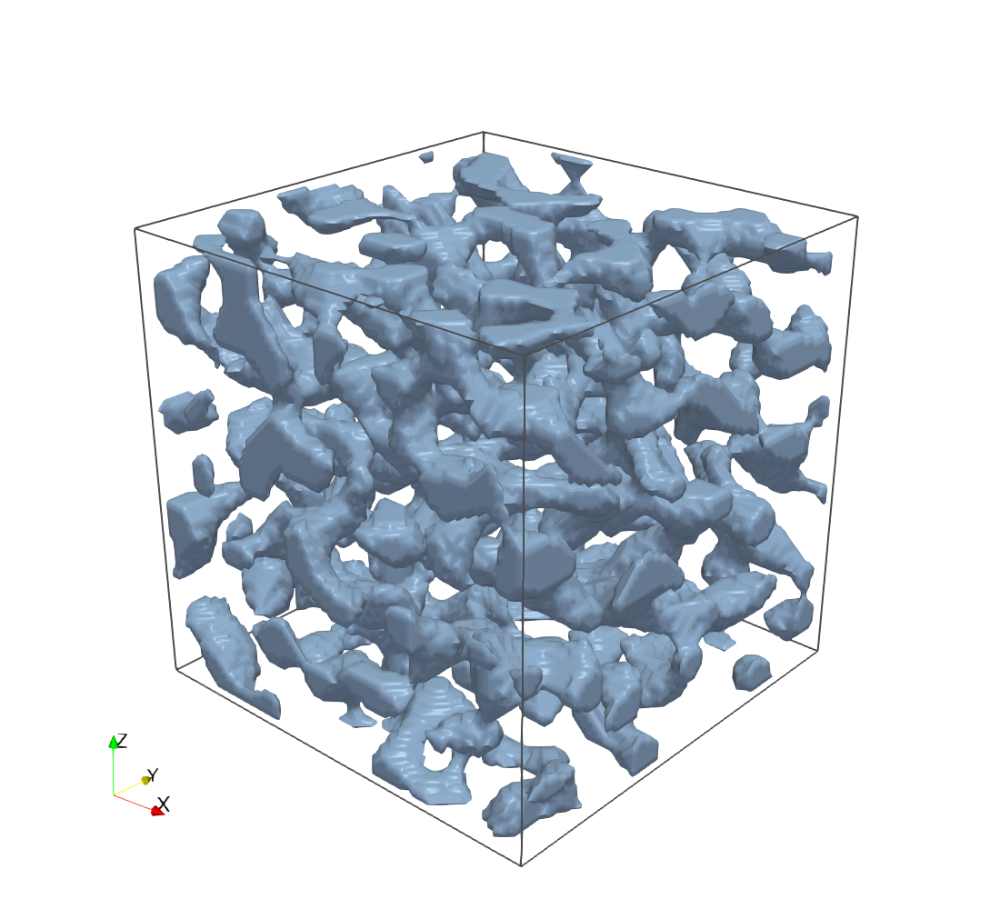
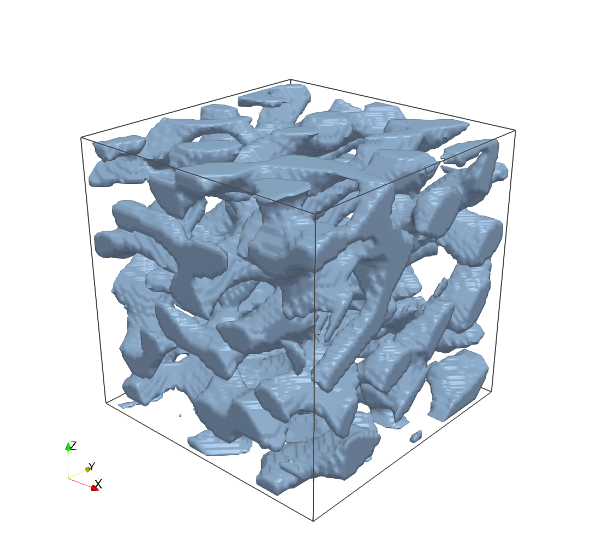
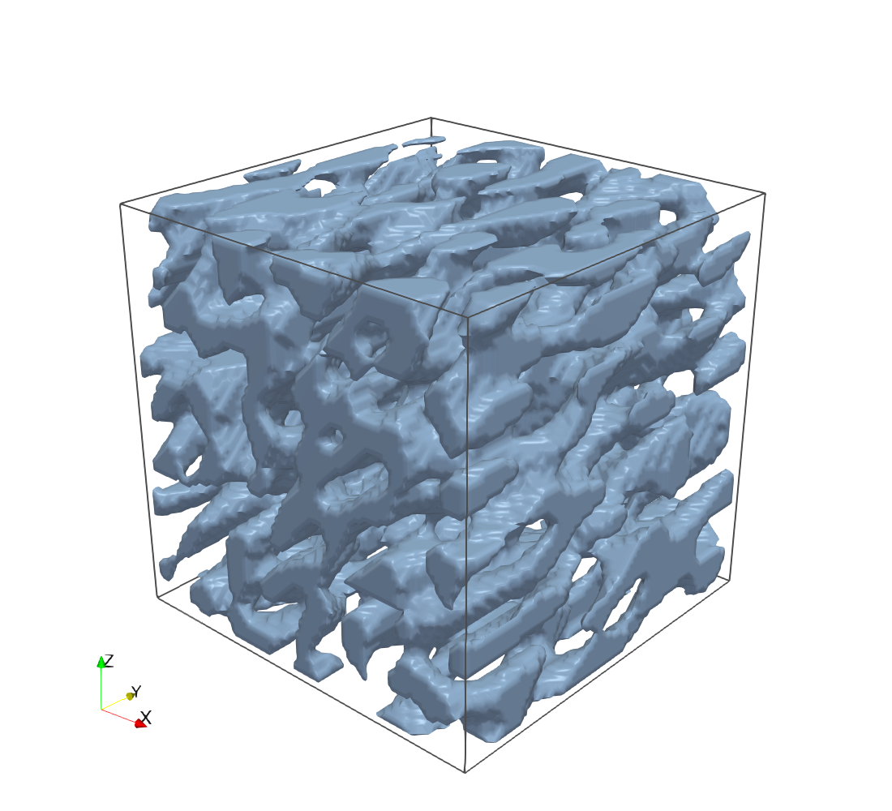
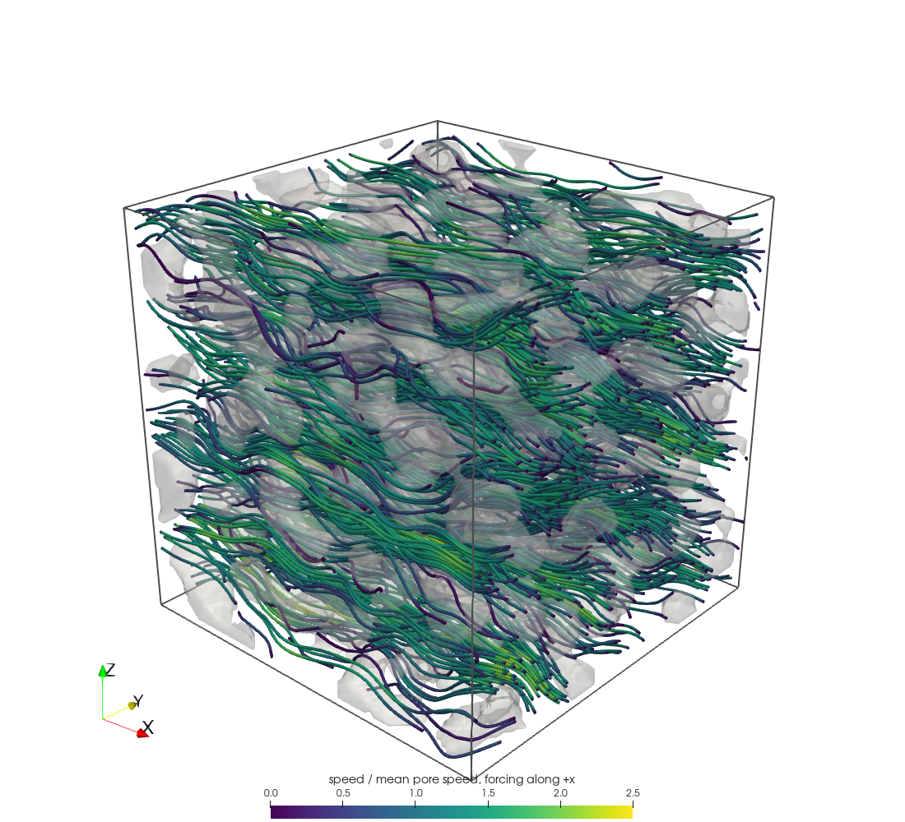
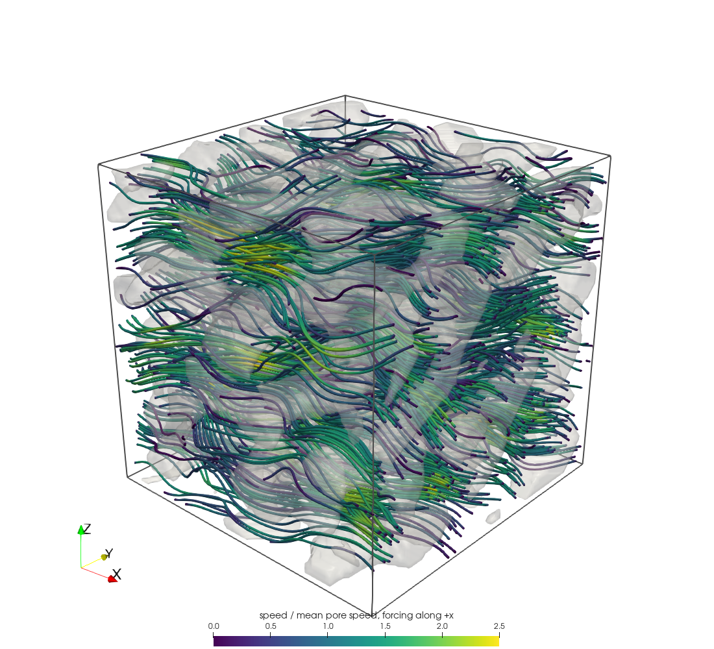
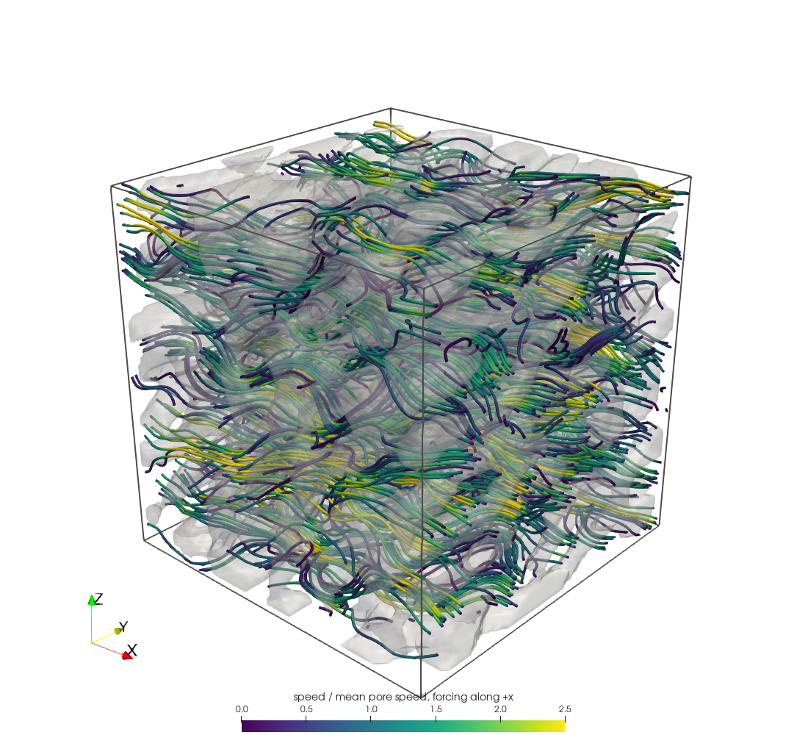
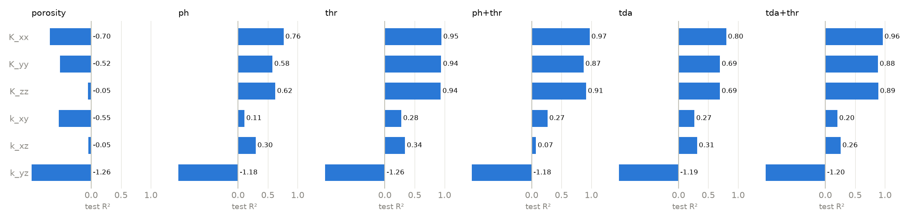
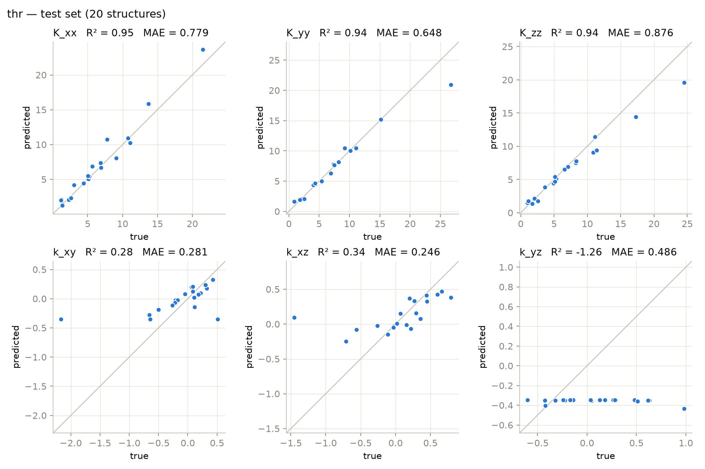

# Task B — permeability tensor from directional pore-space topology

**Goal.** Predict the components of the permeability tensor `K_ij` of a
three-dimensional porous medium from its voxelized geometry, using two
direction-aware topological descriptors and gradient-boosted trees.

Reference: R. Topolnicki, P. Dłotko, M. Matyka, *Permeability tensor of
anisotropic porous media from directional pore-space topology*
(code and full dataset: <https://github.com/dioscuri-tda/perm-tensor-topology>).

<p align="center">
  
  
  
</p>
<p align="center"><em>The first three structures: <code>sample_000000</code> (isotropic, porosity 0.80),
<code>sample_000001</code> (moderately anisotropic, 0.75) and <code>sample_000002</code>
(strongly anisotropic, 0.66). The solid phase is shown; the fluid flows through the rest.
Rendered in ParaView.</em></p>

<p align="center">
  
  
  
</p>
<p align="center"><em>Streamlines of the steady Stokes flow in the same three structures, driven by a
body force along <code>+x</code> (solid in transparent grey; colour: speed in units of the mean pore
speed). The mean flow is not parallel to the force: its direction is the first column of
<code>K</code>, so the sideways drift is the off-diagonal permeability — <code>q_y/q_x = k_xy/K_xx</code>
= 0.001, 0.09 and 0.16 for the three structures.</em></p>

These pictures are illustrations only: the velocity fields come from the
lattice-Boltzmann solver of the paper's repository and are not part of this
repository — the hands-on uses the published permeability values as labels.

## Data

| file | content |
|---|---|
| `data/structures.npz` | 100 structures, bit-packed; `00_prepare_data.sh` unpacks them to `data/structures/sample_000000.raw … sample_000099.raw` |
| `data/permeability.csv` | the labels, one row per structure |

**Structures.** Binary 80×80×80 arrays, `1` = solid, `0` = pore, periodic in all
three directions. They are the first 100 structures of the `aniso3d` dataset of
the paper: thresholded random fields whose correlation lengths differ along
three randomly oriented principal axes. A third of them is isotropic (`iso`),
a third moderately (`mod`) and a third strongly (`strong`) anisotropic; the
porosity ranges from 0.65 to 0.90. Because the principal axes are *not* aligned
with the coordinate axes, the permeability tensor has non-zero off-diagonal
components.

> **Array order.** The `.raw` files are indexed `[z, y, x]` (x varies fastest),
> after a 12-byte header. `common/structures.py` (`load_structure`) reads them.
> Directions on the command line are always given as `(dx, dy, dz)`.

**Labels.** Darcy's law for an anisotropic medium reads
`q_i = −(K_ij / μ) ∂_j p`: the permeability is a symmetric 3×3 tensor. Its
diagonal says how easily the fluid flows along an axis; an off-diagonal
component `k_xy` says how much a pressure gradient along `y` deflects the flow
towards `x`. The values in `data/permeability.csv` are copied from the dataset
of the paper (lattice units, i.e. voxel²).

| columns | meaning |
|---|---|
| `name` | structure name, the key used everywhere |
| `stratum` | anisotropy class of the generator: `iso`, `mod`, `strong` |
| `aniso_A, aniso_B, e1_*, e2_*` | anisotropy ratios and principal axes of the generator |
| `porosity` | pore volume fraction |
| `K_xx, K_yy, K_zz` | **diagonal** components — always positive, span 1.5 decades |
| `k_xy, k_xz, k_yz` | **off-diagonal** components (symmetrised) — small, of either sign |
| `k1, k2, k3, fa` | principal permeabilities and fractional anisotropy |

## The descriptors

Two filtrations are computed for each probing direction **d**:

**TDA — cone filtration of the solid phase** (as in task A). Every solid voxel
gets `1 − (fraction of solid in a double cone along d)`; persistent homology of
this field gives the persistence images `ph_<d>_<i>` (3 × 10×10 = 300 numbers
per direction), and together with two local orientation channels it gives the
Euler characteristic profile `ecp_<d>_<i>` (7³ = 343 numbers per direction;
Julia).

**THR — throat filtration of the pore space.** Permeability is controlled by
the narrowest constrictions (*throats*) along the flow path, and a throat is a
radius, not a solid fraction. Take the distance transform of the pore space,
`dt` = radius of the largest sphere centred at a pore voxel; then for each pore
voxel walk a few voxels along ±**d** and keep the *smallest* `dt` met:

```
f(voxel) = 1 − min(dt along the walk, R_cap) / R_cap           solid voxels: 1.25
```

Wide channels along **d** enter the sublevel sets first; two pores connected
through a throat of radius `r` merge at `t = 1 − r / R_cap`, so the death times
of H0 classes *are* throat radii. Persistence images of this field are the
columns `thr_<d>_<i>` (300 numbers per direction). No Julia needed.

Nine directions are used: the axes `[1 0 0] [0 1 0] [0 0 1]` and the six
**signed** face diagonals `[1 1 0] [1 −1 0] [1 0 1] [1 0 −1] [0 1 1] [0 1 −1]`.
The signed pairs are what makes the off-diagonal components accessible:
`k_xy = (K_[110] − K_[1−10]) / 2`, the difference between the permeabilities
along the two diagonals of the xy-plane. The direction tag in a column name is
the direction with underscores, e.g. `thr_1_-1_0_17`.

## Running the task

```bash
bash 00_prepare_data.sh               # seconds
bash 01_compute_descriptors.sh        # the expensive step, see below; --no-julia skips ECP
bash 02_build_dataset.sh              # seconds
bash 03_train.sh                      # 2-3 minutes
```

or `bash run_all.sh [--no-julia] [--axes-only] [--workers=N]`.

| step | script | does | writes |
|---|---|---|---|
| 0 | `00_prepare_data.sh` | unpack the structures | `data/structures/*.raw` |
| 1 | `01_compute_descriptors.sh` | cone filtration → PH and ECP; throat filtration → PH; per direction; collect | `descriptors/ph.csv`, `thr.csv`, `ecp.csv` |
| 2 | `02_build_dataset.sh` | join descriptors and labels on `name` | `dataset.csv` |
| 3 | `03_train.sh` | CatBoost per target and feature set; metrics on the test set; plots | `results/` |

**Cost of step 1** (100 structures, 9 directions, two filtrations): about 25
minutes on a 14-core workstation with ECP. The ECP is the most expensive
part: with `--no-julia --axes-only` the whole pipeline, training included,
takes about 5 minutes on the same machine. It scales inversely with
the number of cores, and `--axes-only` (3 directions instead of 9) cuts it to a
third — at the price of the off-diagonal components, which need the diagonals.
Peak memory is about 0.5 GB per worker (`--workers=N` lowers it). The step is
resumable.

**No time or no Julia?** `bash 02_build_dataset.sh --reference` builds the
dataset from the shipped tables in `reference/descriptors/` (PH, THR and ECP,
all 9 directions), and `03_train.sh` then trains everything.

The parameters of every step (cone size, `R_cap`, walk length, image ranges,
targets, seed) are plain variables at the top of the corresponding bash script.

### The model

`common/train_catboost.py` is intentionally minimal:

* one fixed split: 60 structures train, 20 validation, 20 test (`SEED=0`);
* one `CatBoostRegressor` per target (RMSE loss, 1000 iterations,
  learning rate 0.05, depth 4; for wide tables only a random subset of ~500
  features is tried at each split);
* the validation set only selects the best iteration (early stopping);
* **R², MAE and RMSE are computed on the 20 test structures.**

Every feature set uses the same split. Per feature set, `results/<set>/`
contains `metrics.csv`, `predictions.csv`, `parity.png` and `importance.png`.

| feature set | columns | paper name |
|---|---|---|
| `porosity` | `porosity` | — |
| `ph` | `ph_*` | part of TDA |
| `thr` | `thr_*` | THR |
| `ph+thr` | `ph_*`, `thr_*` | — |
| `tda` | `ecp_*`, `ph_*` (needs ECP) | TDA |
| `tda+thr` | `ecp_*`, `ph_*`, `thr_*` (needs ECP) | TDA + THR |

## Reference results

Obtained with the default settings (`bash run_all.sh`); the files are in
`reference/results/`. Test R² (20 test structures, single split, `SEED=0`);
MAE values are in `reference/results/summary.md`.

| target | porosity | ph | thr | ph+thr | tda | tda+thr |
|---|---:|---:|---:|---:|---:|---:|
| K_xx | -0.695 | 0.764 | 0.950 | 0.972 | 0.799 | 0.962 |
| K_yy | -0.522 | 0.577 | 0.945 | 0.871 | 0.695 | 0.881 |
| K_zz | -0.053 | 0.624 | 0.936 | 0.912 | 0.694 | 0.887 |
| k_xy | -0.546 | 0.109 | 0.277 | 0.266 | 0.267 | 0.203 |
| k_xz | -0.048 | 0.295 | 0.339 | 0.072 | 0.312 | 0.257 |
| k_yz | -1.264 | -1.182 | -1.257 | -1.177 | -1.195 | -1.198 |
| **mean** | -0.521 | 0.198 | 0.365 | 0.319 | 0.262 | 0.332 |

<p align="center"></p>

How to read this:

* **Diagonal components.** Porosity alone fails here (R² < 0: worse than
  predicting the mean) — two media of equal porosity but different pore size
  have very different permeabilities. The throat descriptor **THR** reaches
  R² ≈ 0.94–0.95 from 60 training structures, well ahead of the cone-based
  descriptors (0.6–0.8): it measures the quantity that controls the flow. The
  paper reports 0.99 (THR) and 0.97 (TDA) on 5000 structures.
* **Off-diagonal components** are much harder with this little data: R² ≈
  0.1–0.3 for `k_xy` and `k_xz`. The paper reaches ≈ 0.85 with THR, but its
  learning curves show that the off-diagonals are exactly the components that
  need thousands of structures.
* **`k_yz` is an instructive failure**, not a bug: all models score R² ≈ −1.2.
  Look at `best_iteration` in `metrics.csv` — it is ≈ 0, so early stopping kept
  an (almost) empty model that predicts the training mean. On this split the
  training set contains a few strongly negative `k_yz` outliers, so its mean
  (−0.36) is far from the test mean (+0.10), and a constant prediction that is
  off by more than the test standard deviation gives a strongly negative R².
  With `SEED=1` the THR model reaches R² = 0.39 on `k_yz`, with `SEED=2`
  about 0; `k_xy` moves between 0.14 and 0.48. Twenty test structures do not
  make a benchmark.

Example of the per-model output, `reference/results/thr/parity.png`:

<p align="center"></p>

## Things to try

1. **Another seed.** Set `SEED=1` in `03_train.sh` and rerun. Which
   conclusions survive, which do not?
2. **Use the symmetry.** `k_xy = (K_[110] − K_[1−10]) / 2` suggests feeding the
   model the *difference* of the descriptors along the two signed diagonals
   instead of both raw vectors. In Python, add columns
   `thr_1_1_0_i − thr_1_-1_0_i` to `dataset.csv` and train on them alone for
   `k_xy`. Does it help? (It is an odd function under the reflection y → −y,
   like `k_xy` itself.)
3. **Read `importance.png`.** For `K_xx`, which directions carry the
   importance? Is it the same for `ph` and for `thr`?
4. **Direction matters.** Train on a single direction:
   ```bash
   python ../common/train_catboost.py --dataset dataset.csv \
       --targets K_xx K_yy K_zz --features thr --directions 1_0_0 --label thr_x_only
   ```
5. **Predict the logarithm.** `K_xx` spans 1.5 decades. Add a column
   `log_K_xx` to the dataset and predict it — what happens to the errors of the
   least permeable structures?
6. **Change the throat filtration.** `HORIZON` (walk length) and `RCAP` in
   `01_compute_descriptors.sh`; `HORIZON=0` would make the descriptor
   non-directional (delete `work/` before recomputing).
7. **Look at a filtration.** In Python:
   ```python
   import sys; sys.path[:0] = ["scripts", "../common"]
   from structures import load_structure
   import filtration_throat3d as thr
   s = load_structure("data/structures/sample_000002.raw")      # [z, y, x]
   f = thr.compute(s, direction=(1, 0, 0))                      # (dx, dy, dz)
   ```
   Plot a slice of `f` for two different directions.

## Files

```
00_prepare_data.sh  01_compute_descriptors.sh  02_build_dataset.sh  03_train.sh  run_all.sh
data/structures.npz, data/permeability.csv
scripts/filtration3d.py          cone filtration (TDA)        python scripts/filtration3d.py --self-test
scripts/filtration_throat3d.py   throat filtration (THR)      python scripts/filtration_throat3d.py --self-test
scripts/structure_io3d.py        .raw reader used by the two filtrations
reference/descriptors/           ph.csv, thr.csv, ecp.csv for all 100 structures
reference/results/               summary and plots of the reference run
figures/                         ParaView renderings of sample_000000 … sample_000002
                                 (geometry, and *_flow.png: streamlines under x-forcing)
```
