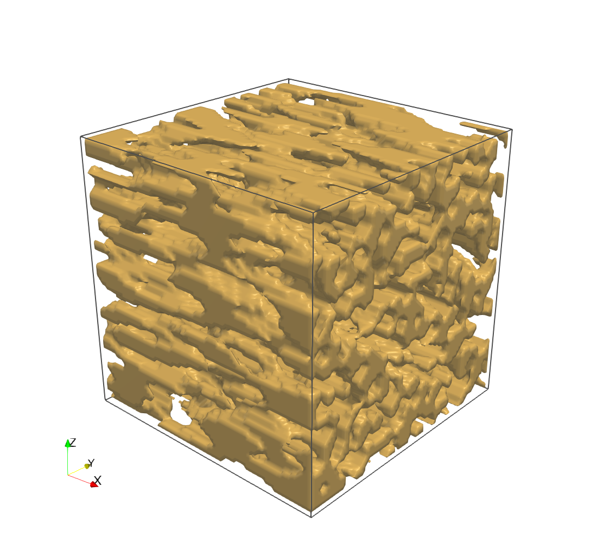
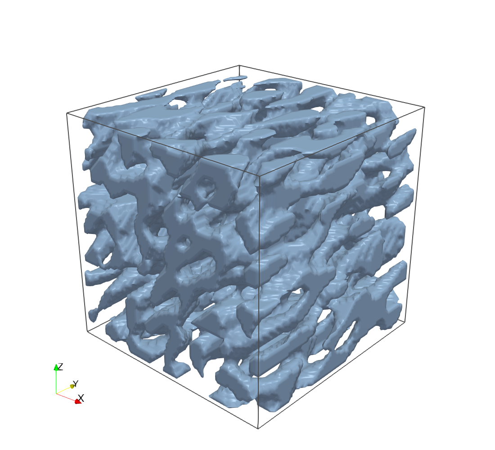

# Topological data analysis for porous materials — hands-on

A hands-on session on **direction-aware topological descriptors** of porous
microstructures and their use for predicting two tensorial properties directly
from geometry:

| | task | property | structures | paper |
|---|---|---|---|---|
| **A** | [`A_elasticity/`](A_elasticity/) | elastic stiffness tensor `C_ij` | 100 anisotropic nanoporous-metal-like structures | [arXiv:2604.08105](https://arxiv.org/abs/2604.08105) |
| **B** | [`B_permeability/`](B_permeability/) | permeability tensor `K_ij` | 100 anisotropic periodic porous media | *Permeability tensor of anisotropic porous media from directional pore-space topology* |

Both tasks follow the same four steps, each wrapped in one bash script:

```
00_prepare_data.sh          unpack the 100 voxelized structures (80^3 voxels each)
01_compute_descriptors.sh   structure -> directional filtration -> topological descriptors
02_build_dataset.sh         descriptors + labels -> one training table
03_train.sh                 CatBoost, one train/validation/test split, metrics and plots
```

No deep learning and no GPU are involved: the models are gradient-boosted trees
([CatBoost](https://catboost.ai)) trained on vectorized topological descriptors.

<p align="center">
  
  &nbsp;&nbsp;
  
</p>

## The idea in one paragraph

Classical topological descriptors (persistent homology, Euler characteristic
curves) do not change when the coordinate axes are permuted, so they cannot tell
the stiff direction of a material from the soft one, or the direction of easy
flow from the blocked one. Stiffness and permeability are tensors, so the
direction is the whole point. The remedy used here is to put the direction into
the **filtration**: for a chosen probing direction **d**, every voxel gets a
value that measures how the material (task A, B) or the pore space (task B)
continues *along d*. Topology is then computed for this direction-dependent
scalar field, once per direction, and the resulting vectors are concatenated.

Two kinds of topological summaries are used:

* **PH** — persistent homology of the filtration (connected components, tunnels
  and cavities with their birth and death scales), vectorized as
  **persistence images**. Computed in Python with [GUDHI](https://gudhi.inria.fr).
* **ECP** — the **Euler characteristic profile**, a multi-parameter
  generalisation of the Euler characteristic curve, computed from three
  filtration channels at once. Computed in **Julia** with
  [ECP_toolkit](https://github.com/Malinon/ECP_toolkit).

## Installation

### Python (required)

Python ≥ 3.10. Either a virtual environment in the repository
(the scripts pick up `.venv/` automatically):

```bash
python -m venv .venv
.venv/bin/pip install -r requirements.txt
```

or conda:

```bash
conda env create -f environment.yml
conda activate tda-porous
```

The dependencies are `numpy scipy pandas numba gudhi catboost scikit-learn matplotlib tqdm`
— PyTorch is **not** needed. If you use another interpreter, point the scripts to
it with `PYTHON=/path/to/python bash 01_compute_descriptors.sh`.

### Julia (optional, for the ECP descriptors)

Install [Julia](https://julialang.org/downloads/) (tested with 1.8 and newer), then
from the repository root:

```bash
julia --project=julia julia/setup.jl
```

This installs the `Ecp` package (not in the General registry, so it comes from
GitHub at a pinned commit) together with `NPZ` and `Glob` into the local project
`julia/`; nothing global is modified.

### Working without Julia

Julia is only needed for one step, the ECP. Every script accepts the flag

```bash
--no-julia        # equivalently: USE_JULIA=0
```

which declares that Julia is not available: the ECP step is skipped, the dataset
is built from the persistent-homology descriptors only, and the models that need
ECP are not trained. **Without the flag the ECP is required**, and the scripts
stop with an explanation if Julia or the `Ecp` package is missing.

There is a second way around Julia (and around the computing time): the
descriptor tables of all 100 structures, ECP included, are shipped in
`reference/descriptors/` of each task. `bash 02_build_dataset.sh --reference`
uses them instead of your own, after which `03_train.sh` runs everything.

| you have | run | you get |
|---|---|---|
| Python + Julia | `bash run_all.sh` | everything, computed by you |
| Python only | `bash run_all.sh --no-julia` | PH (and THR) descriptors and models |
| Python only, little time | `bash 00_prepare_data.sh; bash 02_build_dataset.sh --reference; bash 03_train.sh` | all models from the shipped descriptors |

## Quick start

```bash
cd A_elasticity            # or B_permeability
bash 00_prepare_data.sh
bash 01_compute_descriptors.sh        # add --no-julia if Julia is not installed
bash 02_build_dataset.sh
bash 03_train.sh
```

or simply `bash run_all.sh [--no-julia]`. All scripts share these options
(`--help` prints them):

| option | meaning |
|---|---|
| `--no-julia` | do not require Julia; skip ECP and everything that depends on it |
| `--reference` | (`02`) build the dataset from the shipped descriptor tables |
| `--axes-only` | (`01`) probe only the three coordinate axes instead of all directions — about 2–3× faster |
| `--workers=N` | number of CPU cores (default: all) |

Step 01 is the only expensive one; see the task READMEs for timings. It is
resumable — an interrupted run continues where it stopped.

## Repository layout

```
common/                     code shared by both tasks
  structures.py             unpack / load structures, export to VTK for ParaView
  persistence_images.py     filtration -> persistent homology -> persistence images (GUDHI)
  ecp.jl                    filtration -> Euler characteristic profile (Julia)
  collect_descriptors.py    per-structure vectors -> one table per descriptor kind
  build_dataset.py          descriptor tables + labels -> dataset.csv
  train_catboost.py         split, train, test metrics, parity and importance plots
  summarize_results.py      comparison table and figure over all feature sets
  cli.sh                    the shared command-line flags of the bash scripts
A_elasticity/               task A (see its README)
B_permeability/             task B (see its README)
  data/                     structures.npz (bit-packed) and the label table
  scripts/                  the task-specific filtrations
  reference/descriptors/    precomputed descriptor tables
  reference/results/        the reference results to compare with
  figures/                  ParaView renderings of the first three structures (B: also the flow)
julia/                      Julia project for the ECP step
```

Files produced by the pipeline (`data/structures/`, `work/`, `descriptors/`,
`dataset.csv`, `results/`) are not tracked by git.

## Reference results

Each task ships the results obtained with the default settings in
`reference/results/` (`summary.md`, `summary.png`, and the per-model plots), and
its README shows the table. With 100 structures and a 20-structure test set the
numbers are **noisy** — they are a sanity check for your run, not a benchmark.
The papers use 500–5000 structures and 5-fold cross-validation.

The descriptor computation is deterministic, so your tables should match the
reference ones up to floating-point noise; the CatBoost results are seeded but
can differ slightly between library versions and thread counts.

## Looking at the structures

`common/structures.py to-vtk` writes a structure as a VTK file for
[ParaView](https://www.paraview.org):

```bash
python common/structures.py to-vtk A_elasticity/data/structures/rtp_000.npy rtp_000.vtk
```

In ParaView: open the file, apply a *Contour* filter on `solid` at 0.5 (or a
*Threshold* at 0.5–1) to see the solid phase.

## Sources and credits

The descriptor code is taken from the repositories accompanying the two papers,
reduced to what the hands-on needs:

* R. Topolnicki, M. Bogdan, J. Malinowski, B. Naskręcki, M. Harańczyk, P. Dłotko,
  *Direction-aware topological descriptors for elastic stiffness tensor
  prediction in porous materials*, arXiv:2604.08105 —
  <https://github.com/dioscuri-tda/direction-aware-tda-for-porous-materials>
* R. Topolnicki, P. Dłotko, M. Matyka, *Permeability tensor of anisotropic
  porous media from directional pore-space topology* —
  <https://github.com/dioscuri-tda/perm-tensor-topology>

The structures and labels are subsets of the datasets published there (the
first 100 structures of the RTP dataset and of the `aniso3d` dataset,
respectively); the label values are copied from those datasets unchanged. No
physics solver is part of this repository. The full datasets, the
non-topological baselines and the cross-validated experiments are in the
repositories above.

## License

* **Code** (everything except the files listed below): MIT, see [`LICENSE`](LICENSE).
* **Data** (`*/data/`, `*/reference/`, `*/figures/`): Creative Commons
  Attribution 4.0 International (CC BY 4.0), see [`LICENSE-DATA`](LICENSE-DATA).
  If you use the data, please cite the corresponding paper above.
